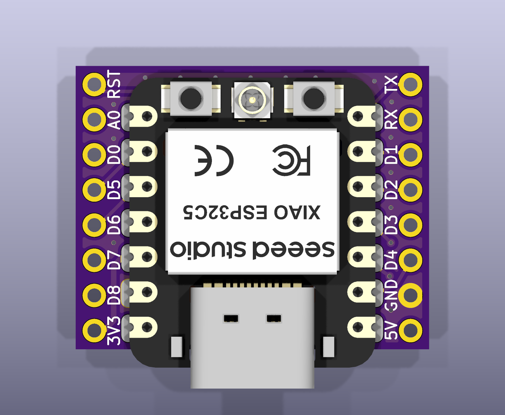
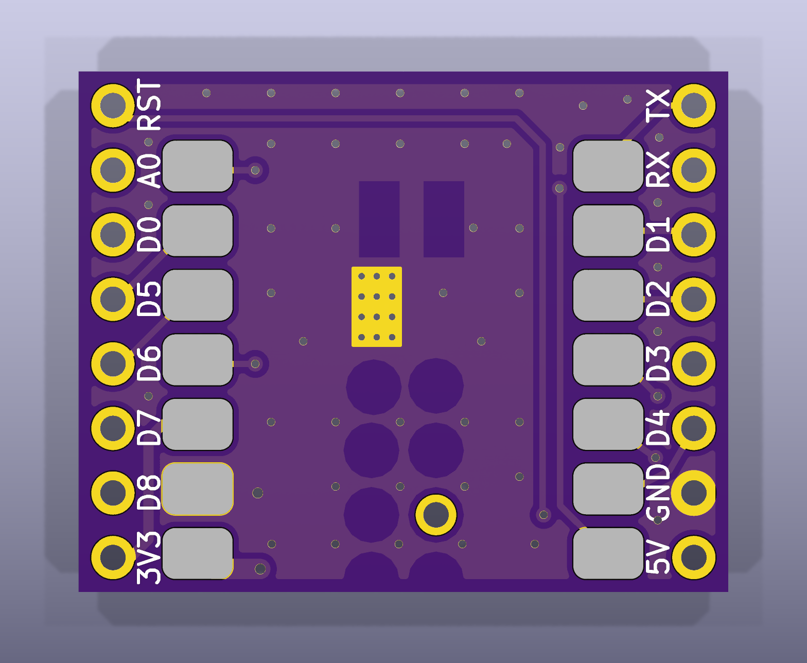
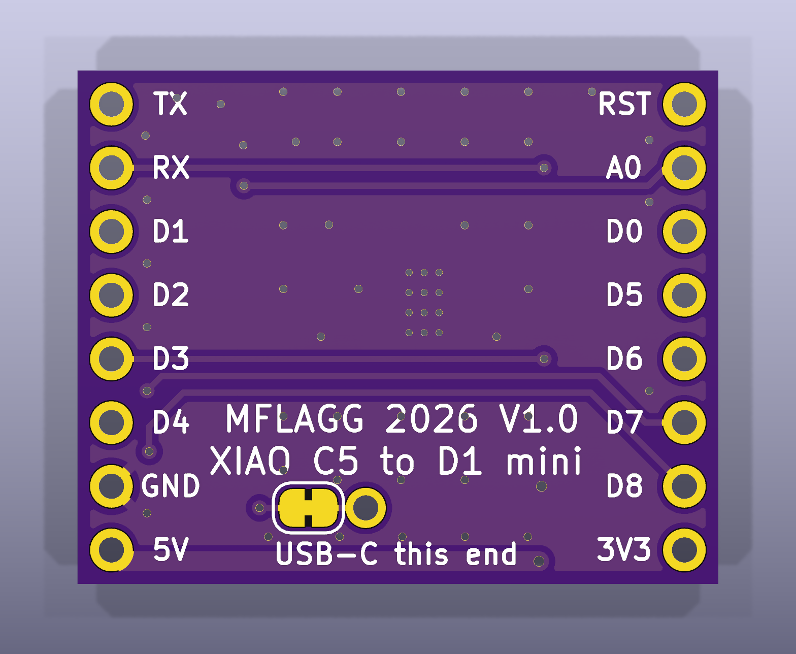

# XIAO ESP32-C5 to Wemos D1 mini interposer

> [!IMPORTANT]
> V1.0 hasn't been built or tested yet.\
> Use it at your own risk and without expectation of support.

A small interposer that lets a surface-mounted [Seeed Studio XIAO ESP32-C5](https://wiki.seeedstudio.com/xiao_esp32c5_getting_started/) stand in for a Wemos D1 mini (ESP8266). It breaks the XIAO out to the D1 mini's two 1×8 rows with the D1 mini's pin spacing, so it drops into D1 mini sockets and takes D1 mini shields.

It was built for the [AirGradient DIY Basic](https://www.airgradient.com/documentation/kb/kb-old-instructions-the-airgradient-diy-air-quality-sensor-basic-version-pcb-version-3-0). The pin map also aims to keep the board useful as a general D1 mini replacement.

Schematic: [c5-d1-interposer-schematic.pdf](c5-d1-interposer-schematic.pdf) (source: `c5-d1-interposer.kicad_sch`)

### AI disclosure

AI was used to generate this PCB with human guidance and revision. Provided without support.

## Fabrication

I had 3 of these fabbed 11/2026 at OSH Park for $4.05 including shipping. I went with 2oz copper, 0.8mm thickness.

## SHT3x: rewire VIN to 3.3 V

> [!WARNING]
> The SHT3x's VIN trace must be cut and rewired to 3.3 V before the XIAO goes in.

The AirGradient board powers the SHT3x module from 5 V. If that module has its own I2C pull-ups to VIN, SDA and SCL idle above the C5's 3.6 V absolute maximum. With 10k to 5 V on the module and the OLED shield's 4.7k to 3.3 V, the lines idle at about 3.84 V.

1. Cut the top-layer trace from the SHT3x footprint's VIN pad (the square pad) to the PMS5003 4-pin header's 5V pad. It runs about 6 mm straight across between the two pads, and feeds only that pad.
2. Wire the VIN pad to a 3V3 pad in the expansion grid, the 4×5 pad grid above the S8. Its columns, left to right, are 5V, 3V3, GND, SDA and SCL.

## Pin map

| D1 mini pin | XIAO pin           | C5 GPIO | Function on the C5                         | AirGradient use                                                       |
| ----------- | ------------------ | ------- | ------------------------------------------ | --------------------------------------------------------------------- |
| TX          | D6                 | GPIO11  | UART0 TX (U0TXD)                           | -                                                                     |
| RX          | D7                 | GPIO12  | UART0 RX (U0RXD)                           | -                                                                     |
| D1          | D5                 | GPIO24  | I2C SCL                                    | SCL: OLED, SHT3x                                                      |
| D2          | D4                 | GPIO23  | I2C SDA                                    | SDA: OLED, SHT3x                                                      |
| D3          | D10                | GPIO10  | GPIO / UART TX                             | ESP TX → SenseAir S8 RX                                               |
| D4          | D1                 | GPIO0   | GPIO / UART RX                             | SenseAir S8 TX → ESP RX                                               |
| D5          | D8                 | GPIO8   | GPIO / SPI SCK                             | PMS5003 TX → ESP RX                                                   |
| D6          | D9                 | GPIO9   | GPIO / SPI MISO                            | ESP TX → PMS5003 RX                                                   |
| D7          | D3                 | GPIO7   | GPIO / SPI MOSI (FSPID). **Strapping pin** | -                                                                     |
| D8          | D2                 | GPIO25  | GPIO / SPI CS. **Strapping pin**           | -                                                                     |
| A0          | D0                 | GPIO1   | ADC1_CH0                                   | -                                                                     |
| D0          | -                  | -       | Not connected                              | -                                                                     |
| RST         | EN pad (underside) | CHIP_PU | Chip reset, active low, through JP1        | -                                                                     |
| 3V3         | 3V3                | -       | XIAO 3.3 V output                          | OLED power, SHT3x power after the [rewire](#sht3x-rewire-vin-to-33-v) |
| 5V          | 5V                 | -       | XIAO VBUS (USB 5 V)                        | S8, PMS5003 power                                                     |
| G           | GND                | -       | Ground                                     | -                                                                     |

## Differences from a real D1 mini

Most D1 mini projects and shields should work, but check these first:

- **No onboard pull-ups or pull-downs.** The D1 mini has 10k pull-ups on D3 and D4 and a 10k pull-down on D8, because those are ESP8266 boot pins. This board has none of them. Use the C5's internal pull-ups or pull-downs in firmware if something depends on them.
- **No LED on D4.**
- **A0 is a raw ADC input**, 0–3.3 V straight into GPIO1. The D1 mini has a 220k/100k divider in front of the ESP8266's 1 V ADC, and some shields count on it. For example, the battery shield's A0 jumper adds a 130k series resistor sized for that divider, so here it would put up to 4.2 V on GPIO1 through 130k. Don't use it.
- **Only two hardware UARTs.** The C5 has UART0 and UART1 (its low-power UART isn't on the XIAO's pads). Any of them can be routed to any GPIO. If you use both for peripherals, as the AirGradient's SenseAir S8 and PMS5003 do, move the logger to the USB serial port. The ROM bootloader still prints its boot messages on the TX pin (GPIO11) at reset.
- **RST resets the C5**, as on a D1 mini. It's wired to the XIAO's EN pad through a solder-feed hole (see [Assembly](#assembly)). Software reboots (OTA, `restart`) don't pull EN low, so a shield that hangs its own chip's reset on RST only gets reset by a power cycle, the XIAO's reset button, or something pulling RST. To disconnect RST from EN, cut the trace between JP1's pads on the back, next to the solder-feed hole. Bridge the pads with solder to reconnect it.
- **Power:**
  - **5V** is tied straight to the XIAO's 5V pad, which is VBUS after the XIAO's USB load switch. You can power the board through the 5V pin instead of USB, but there's no diode between them: don't connect a 5 V supply to the 5V pin while USB is plugged in.
  - **3V3** is the XIAO's 3.3 V output, which sits behind a load switch on the XIAO. Treat it as an output only and don't power the board through it.

## Assembly

1. Optionally, put a thin layer of thermal paste on the bare thermal pad.
2. Solder the XIAO flat on the top side, with its USB-C port at the edge marked **USB-C this end** on the back silkscreen. Solder all 14 castellated edges first.
3. From the back, feed solder into the hole near the USB end. It sits under the XIAO's EN test pad (underside pad 17) and connects it to the RST pin.

# Sources

- **XIAO symbol and footprint:** derived from Seeed Studio's [OPL KiCad library, XIAO Family](https://github.com/Seeed-Studio/OPL_Kicad_Library/tree/master/XIAO%20Family). Underside pad positions and functions were checked against Seeed's [XIAO ESP32-C5 V1.1 schematic and PCB](https://wiki.seeedstudio.com/xiao_esp32c5_getting_started/).
- **XIAO 3D model:** not included, because GrabCAD models can't be redistributed. Download "[Seeed Studio XIAO ESP32-C5](https://grabcad.com/library/seeed-studio-xiao-esp32-c5-1)" from GrabCAD and save it as `lib/c5d1.3dshapes/seeed-studio-xiao-esp32c5.step` to see the XIAO in KiCad's 3D viewer.

# License

- The board design is under the [MIT License](LICENSE).
- The XIAO symbol and footprint (`lib/c5d1.kicad_sym`, `lib/c5d1.pretty/`) are derived from Seeed Studio's OPL KiCad library and stay under [CC BY-SA 4.0](lib/LICENSE.md), including the copies KiCad embeds in the schematic and board files.
